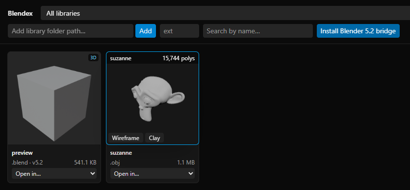

# Blendex

[](https://github.com/g-s-jithesh/blendex/actions/workflows/ci.yml)
[](https://github.com/g-s-jithesh/blendex/releases/latest)
[](LICENSE)

A lightweight 3D asset manager for Windows. Point it at your project folders and it indexes your `.blend`, `.obj`, `.fbx`, `.glb`, `.stl`, `.usd` and other 3D files, shows a thumbnail for each, lets you orbit a 3D preview by hovering a card for 2 seconds, and opens or imports assets into Blender, including straight into the Blender project you already have open.

Everything runs on your own PC. Nothing is uploaded anywhere, and Blendex stays offline unless you turn on update checks.



## Install

1. Download `Blendex-<version>-Setup.exe` from [Releases](https://github.com/g-s-jithesh/blendex/releases) and run it. It installs for your user only (no admin prompt), adds Blendex to the Start menu, and optionally to the desktop.
2. Start **Blendex**. It opens in its own window.
3. Paste a folder path into **Add library folder path…** and click **Add**. Thumbnails appear as Blendex works through the folder.

Windows SmartScreen may warn the first time because the installer is not code-signed: choose **More info → Run anyway**.

### Linux (x86_64, preview)

Needs a desktop session (X11 or Wayland) on glibc 2.35+ (Ubuntu 22.04+, Debian 12+, Fedora 36+) with OpenGL/EGL drivers, which every desktop install already has (Debian/Ubuntu: `libegl1 libgl1`). Everything else, Qt WebEngine included, is in the download.

```sh
tar xzf Blendex-<version>-linux-x86_64.tar.gz
Blendex/install.sh
```

This installs to `~/.local/opt/blendex` and adds Blendex to your app menu; no root needed. Run it again from a newer download to update. `~/.local/opt/blendex/install.sh --uninstall` removes it and keeps your library index in `~/.local/share/dam` (delete that folder to forget your libraries). Other files: log `~/.local/share/dam/blendex.log`, window data `~/.local/share/Blendex`, cache `~/.cache/Blendex`. The Linux build has only been tested in WSL so far, so please [report](https://github.com/g-s-jithesh/blendex/issues) how it runs on your machine.

### Requirements (Windows)

- Windows 10 or 11 (64-bit).
- Microsoft Edge WebView2 Runtime, used to draw the window. It is built into Windows 11 and up-to-date Windows 10; if it is missing, Blendex says so and links to the download.
- [Blender](https://www.blender.org/download/) 4.2 or newer (tested with 5.2 LTS) for thumbnails, 3D previews and imports. Blendex finds it in `C:\Program Files\Blender Foundation` or on your `PATH`. Without Blender, `.blend` files still show the preview image saved inside them.

## Light on RAM and GPU

Measured on a laptop with an NVIDIA RTX 3050 Laptop GPU and Intel UHD Graphics, using Task Manager's numbers (private working set and per-process GPU memory):

| State | RAM | Dedicated VRAM | Shared GPU memory |
|---|---|---|---|
| Open, browsing thumbnails | ~190 MB | 0 MB | ~38 MB |
| 3D preview open (15,744-triangle model) | ~250 MB | 0 MB | ~59 MB |
| After the preview closes | ~210 MB | 0 MB | ~44 MB |

For comparison, version 1.0.1, which opened in an Edge browser window, used about 1,300 MB of RAM across 21 processes.

Why it stays small:

- **No browser.** The interface is drawn by the WebView2 component inside Blendex's own window. No Edge browser, extensions or tabs are started.
- **One 3D view, only while you look.** Cards are plain images. A single 3D viewport is created only after you hover a card for 2 seconds, and it is destroyed, with all of its geometry, textures and its WebGL context, as soon as the pointer leaves. Automated tests sweep the pointer across 20 cards and check that there is never more than one live WebGL context and that every model's GPU buffers and textures are freed.
- **Small proxies.** Previews load a decimated (50% of triangles) and Draco-compressed `.glb` copy of the model, never the original file.
- **Integrated GPU first.** On laptops with two GPUs, Windows draws the window on the integrated GPU, so the dedicated card's VRAM stays free for Blender. In the run above, no dedicated VRAM was used.
- **Thumbnails without Blender.** For `.blend` files, the preview image Blender stores inside the file is read directly, in about 1 ms, before any Blender process starts.
- **Only what you look at is converted.** Adding a library starts no Blender process. A card is sent to Blender once it has been at least half on screen for 0.4 s, or when you hover it, so scrolling quickly past thousands of files starts nothing. In a test library of 30 `.obj` files, adding it started 30 Blender jobs before this change and 0 now. Set `DAM_CONVERT=all` to convert everything up front (see [Configuration](#configuration)).
- **Big libraries load as you scroll.** The grid fetches 200 cards at a time as you near the bottom, and the header counts e.g. **400 of 5000 assets**. Cards off screen are skipped by the browser's layout: with 5000 cards loaded, re-laying out the grid takes about 25 ms instead of about 200 ms.
- **Background work is capped.** Blender conversions run at most a quarter of your CPU cores at a time (configurable, see [Configuration](#configuration)).

Each preview decodes its model in a Draco decoder worker that is shut down as soon as the model is loaded. RAM settles about 20 MB above the idle number within half a minute of a preview closing, because the web engine keeps the 3D code and some caches loaded. Your numbers will vary with the size of the models you preview.

## Using Blendex

- **Search and filter.** Type in **Search by name…**, or enter an extension such as `fbx` in the **ext** box. The library menu at the top switches between libraries.
- **Favourites and tags.** Click the ☆ on a card (or Tab to it and press Enter) to star it. Type in a card's **+ tag** box and press Enter to tag it; click **×** on a tag to remove it. In the header, **★ Favourites** shows only starred assets and the **All tags** menu shows only assets with that tag. Stars and tags stay when you edit the file, and go away when the file is deleted or moved.
- **Hover to orbit.** Hover a card with a **3D** badge for 2 seconds. Drag to orbit, scroll to zoom, press **W** or click **Wireframe** for wireframe, and **C** or **Clay** for a plain clay material. The polycount is shown at the top.
- **Live updates.** Save, add, rename or delete files in a library and the grid updates by itself.
- **Conversion progress.** While Blender builds thumbnails and previews, the header shows e.g. **Converting 2 · 340 queued**. **Pause** lets the running jobs finish and starts no new ones until you click **Resume**; restarting Blendex resumes automatically.
- **Open in…** Each card's menu can:
  - open the file in Blender (`.blend` opens directly; other formats are imported into a new scene),
  - show the file in Explorer,
  - or open Windows' **Open with** picker, to use any other installed program.
- **Update notice (opt-in).** Tick **Check for updates** in the header to see a banner when a newer Blendex is released. The **Get it from GitHub** link opens the release page in your web browser. Offline or failed checks stay silent.
- **Import into the Blender you already have open.** Click **Install Blender X.Y bridge** in the header once, with Blender closed. From then on, every Blender you open is listed in the card menus as **Import into Blender X.Y — yourfile.blend**. The asset is added to that scene as one undoable step (Ctrl+Z removes it). `.blend` files append their objects.
- **Import into the Maya you already have open.** Start Maya once after installing it, close it, then click **Install Maya 2027 bridge** (or your version) in the header. Every Maya you open afterwards is listed as **Import into Maya 2027 — yourscene.mb**. Maya can import `.ma`, `.mb`, `.obj`, `.fbx`, `.usd*`, `.abc` and `.stl`. Maya's own import cannot be undone and clears Maya's undo history, so save first.

### What each file type gets

| Extension | Thumbnail | Hover 3D preview | Open in Blender | Import into an open Blender |
|---|---|---|---|---|
| `.blend` | ✔ (saved preview, then a 512 px render) | ✔ | ✔ opens the file | ✔ appends its objects |
| `.obj`, `.fbx` | ✔ | ✔ | ✔ imported into a new scene | ✔ |
| `.glb`, `.gltf`, `.stl`, `.ply`, `.usd`, `.usda`, `.usdc`, `.usdz`, `.abc` | — | — | ✔ imported into a new scene | ✔ |
| `.ma`, `.mb` | ✔ (needs Maya and Blender) | ✔ | — (use **Open in Maya**) | — (see Maya below) |

Every indexed file can also be shown in Explorer or opened with any app through Windows' **Open with** picker. `.ma`/`.mb` files also get **Open in Maya** if Maya is installed in its default folder (tested with Maya 2027).

## Where Blendex keeps things

| What | Where | Safe to delete? |
|---|---|---|
| The app | `%LOCALAPPDATA%\Programs\Blendex` | Uninstall from **Settings → Apps** |
| Library index | `%APPDATA%\dam\dam.sqlite` | Yes, but your libraries need adding again. Kept on uninstall |
| Log | `%APPDATA%\dam\blendex.log` | Yes |
| Thumbnails and 3D proxies | a hidden `.cache` folder inside each library | Yes, rebuilt automatically |
| Window cache | `%LOCALAPPDATA%\Blendex` | Yes, removed on uninstall |
| Blender bridge add-on | Blender's user add-ons folder (`dam_bridge.py`) | Disable or remove it in Blender's **Preferences → Add-ons** |
| Maya bridge plug-in | `Documents\maya\<version>\plug-ins\maya_bridge.py` | Untick **Loaded**/**Auto load** in Maya's **Windows → Settings/Preferences → Plug-in Manager**, or delete the file |

Blendex never modifies or deletes your original files.

## Privacy and security

- Blendex only listens on `127.0.0.1` (port 8765), so other computers on your network cannot reach it.
- The Blender and Maya bridges also listen only on `127.0.0.1`, require a random per-session token, and accept only "import this 3D file" requests. They cannot run code sent to them.
- Blender opens your `.blend` files with embedded scripts disabled while making thumbnails.
- Maya scene files can contain code, so before Maya opens one for a thumbnail or an import, Blendex refuses `.ma` files containing anything other than the commands Maya itself writes, disables expressions and script nodes, and does not load references (previews therefore show only the scene's own geometry). The thumbnail job also runs with its own Maya preferences folder and without third-party plug-ins. This lowers the risk of downloaded scenes but is not a sandbox: only add libraries you would open in Maya anyway.
- No telemetry and no network access, apart from Blender and WebView2 themselves, unless you turn on **Check for updates**. That switch is off by default. When it is on, Blendex asks GitHub's public API for the latest release once each time it starts. The request sends nothing about you or your files beyond what any web request carries (your IP address).

## Troubleshooting

| Problem | What to do |
|---|---|
| SmartScreen blocks the installer | **More info → Run anyway**. The installer is not code-signed. |
| "WebView2 Runtime is missing" | Install the [Evergreen WebView2 Runtime](https://developer.microsoft.com/microsoft-edge/webview2/) and start Blendex again. |
| "Port 8765 is used by another program" | Close the program using that port, or a second copy of the development version (`start.bat`), or start Blendex on another port with `DAM_PORT`. |
| Cards stay on **Pending**, or show **Conversion failed** with "Blender not found" when you hover them | Install Blender 4.2+ in the default folder, or point Blendex at it with `DAM_BLENDER` (see below). |
| An open Blender is not listed under **Import into…** | Install the bridge from the header (with Blender closed), then restart Blender. A Blender that is busy rendering is not listed until it is idle. |
| **Install Maya bridge** fails with "start Maya once" | Open that Maya once so it creates its preferences, close it, then install again. Install with Maya closed: a Maya that is open while you install drops the autoload entry when it quits. |
| `.ma`/`.mb` cards fail with "Maya not found" | Install Maya in its default folder, or point Blendex at its `mayapy` with `DAM_MAYAPY`. The first Maya thumbnail after a start can take 30 s or more. |
| A `.ma` card fails with "scene contains commands Blendex will not run" | The file holds MEL that Maya's own writer never produces (often an embedded script or virus). Open it in Maya only if you trust where it came from. |
| Blender prints `Add-on not loaded: "dam_bridge"` at startup | Click **Install Blender X.Y bridge** again in Blendex to reinstall the add-on. |
| Linux: no 3D preview on hover | Chromium turns WebGL off for blocklisted GPUs/drivers and for software rendering (VMs, WSL). Start Blendex with `QTWEBENGINE_CHROMIUM_FLAGS=--ignore-gpu-blocklist ~/.local/opt/blendex/Blendex` (under WSLg also `QT_QPA_PLATFORM=xcb`). |
| Linux: nothing appears, or "Could not load the Qt platform plugin" | Run `~/.local/opt/blendex/Blendex` from a terminal to see the error; on Wayland try `QT_QPA_PLATFORM=xcb`. "Qt WebEngine could not start" means the OpenGL libraries are missing (`sudo apt install libegl1 libgl1 libxcb-dri3-0`). |
| Linux: "Blendex is already running" | Linux doesn't let an app bring another app's window to the front; switch to the open Blendex window. Without `zenity` or `kdialog` the message only goes to the log. |
| Linux: big libraries stop updating live | The file watcher uses one inotify watch per folder. Raise the limit: `echo fs.inotify.max_user_watches=524288 \| sudo tee /etc/sysctl.d/90-blendex.conf && sudo sysctl --system`. |
| Anything else | See `%APPDATA%\dam\blendex.log` and [open an issue](https://github.com/g-s-jithesh/blendex/issues). |

## Configuration

Optional environment variables (set them before starting Blendex):

| Variable | Default | Effect |
|---|---|---|
| `DAM_BLENDER` | newest detected Blender | Full path to the `blender.exe` used for thumbnails and previews |
| `DAM_MAYAPY` | `mayapy` of the newest detected Maya | Full path to the `mayapy.exe` used to read `.ma`/`.mb` for thumbnails and previews |
| `DAM_WORKERS` | a quarter of your CPU cores (at least 1) | How many Blender conversions run at once |
| `DAM_JOB_TIMEOUT` | `600` | Seconds before a stuck conversion is stopped |
| `DAM_CONVERT` | on demand | `all` converts every `.blend`, `.obj` and `.fbx` as soon as it is indexed, instead of only the cards you scroll to or hover |
| `DAM_DB` | `%APPDATA%\dam\dam.sqlite` | Location of the library index |
| `DAM_PORT` | `8765` | Port Blendex listens on (always on `127.0.0.1` only) |

## Known limitations

- Windows only for the installer. The development version may run elsewhere, but only Windows is tested.
- A library cannot be removed, and a failed conversion cannot be retried, from the window yet. Both exist in the API: `DELETE /api/libraries/{id}` and `POST /api/assets/{id}/convert`.
- Importing into an already open app works for Blender only. 3ds Max, Houdini and Cinema 4D are not supported yet.
- Thumbnails and 3D previews are generated for `.blend`, `.obj` and `.fbx` only.
- The installer is not code-signed.

## For developers

Needs Python 3.11+ (3.14 recommended; it can read zstd-compressed `.blend` previews without Blender) and Node.js 20+.

```bat
start.bat
```

runs the development version: backend on port 8765, UI on http://127.0.0.1:5173 with hot reload.

On Linux (or macOS) run `./start.sh` instead. It needs Python 3.11+ with `venv` (Debian/Ubuntu: `sudo apt install python3-venv`) and Node.js 20+; the first run creates `.venv` and installs the packages, and Ctrl+C stops both servers. Blender is found in `/usr/bin`, `/usr/local/bin`, `/snap/bin`, `/opt/blender*/`, `~/blender*/` (unpacked downloads) or on `PATH`. **Show in folder** and **Open in default app** need `xdg-utils`; selecting the file in the folder needs a file manager that implements `org.freedesktop.FileManager1` (Nautilus, Dolphin, Nemo).

To build the installer you also need [Inno Setup 6](https://jrsoftware.org/isinfo.php) (`winget install JRSoftware.InnoSetup`):

```bat
.venv\Scripts\python -m pip install -r packaging\requirements.txt
.venv\Scripts\python packaging\build.py
```

`release\Blendex-<version>-Setup.exe` is the installer and `release\dist\Blendex\` is the unpacked app. The version number lives in `backend/app.py`.

Tests:

```bat
.venv\Scripts\python -m pytest
npm --prefix frontend run test
npx --prefix tests/e2e playwright test -c tests/e2e
```

Tests marked `blender` run the real Blender and are skipped if it is not installed.

| Folder | Contents |
|---|---|
| `backend/` | FastAPI daemon: indexing, file watching, Blender job queue, SQLite, launcher, Blender bridge client |
| `frontend/` | React + TypeScript + Tailwind UI, React Three Fiber 3D preview |
| `scripts/` | Blender-side scripts: proxy export, open-and-import, the bridge add-on and its installer |
| `packaging/` | Desktop launcher, PyInstaller build script, Inno Setup installer |
| `docs/` | API spec (`api_spec.json`) and the `.blend` header and preview format notes |
| `tests/` | pytest, Vitest and Playwright suites |

`CLAUDE.md` describes the API contract and project rules in detail, and `PLAN.md` records decisions and progress.

## Code signing policy

Windows releases are being set up for free code signing by [SignPath.io](https://about.signpath.io/), with a certificate by the [SignPath Foundation](https://signpath.org/). Until that is approved, the installer is unsigned and SmartScreen asks you to confirm (**More info → Run anyway**).

- Only installers built by this repository's [release workflow](.github/workflows/release.yml) from a version tag are signed. Nothing built on a personal machine is.
- Committers and reviewers: [g-s-jithesh](https://github.com/g-s-jithesh) and the [contributors](https://github.com/g-s-jithesh/blendex/graphs/contributors) whose pull requests are reviewed and merged by a maintainer.
- Approvers (each signing request is approved by hand): [g-s-jithesh](https://github.com/g-s-jithesh).
- Privacy: this program will not transfer any information to other networked systems unless specifically requested by the user or the person installing or operating it. The only network request Blendex makes itself is the opt-in update check described under [Privacy and security](#privacy-and-security).

## Contributing

Blendex is a community project, and contributions of every size are welcome: bug reports, ideas, docs and code. Start with [CONTRIBUTING.md](CONTRIBUTING.md), ask questions in [Discussions](https://github.com/g-s-jithesh/blendex/discussions), and please follow the [Code of Conduct](CODE_OF_CONDUCT.md). Report security problems privately as described in [SECURITY.md](SECURITY.md).

## License

[MIT](LICENSE) © 2026 g-s-jithesh and Blendex contributors.
